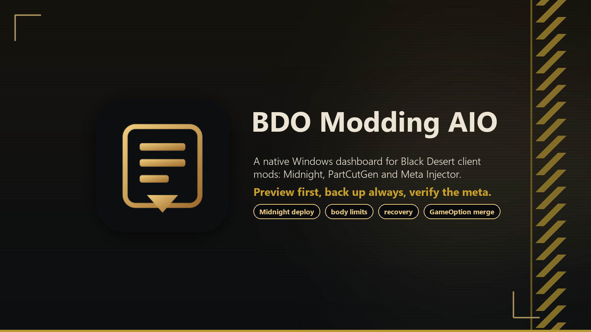
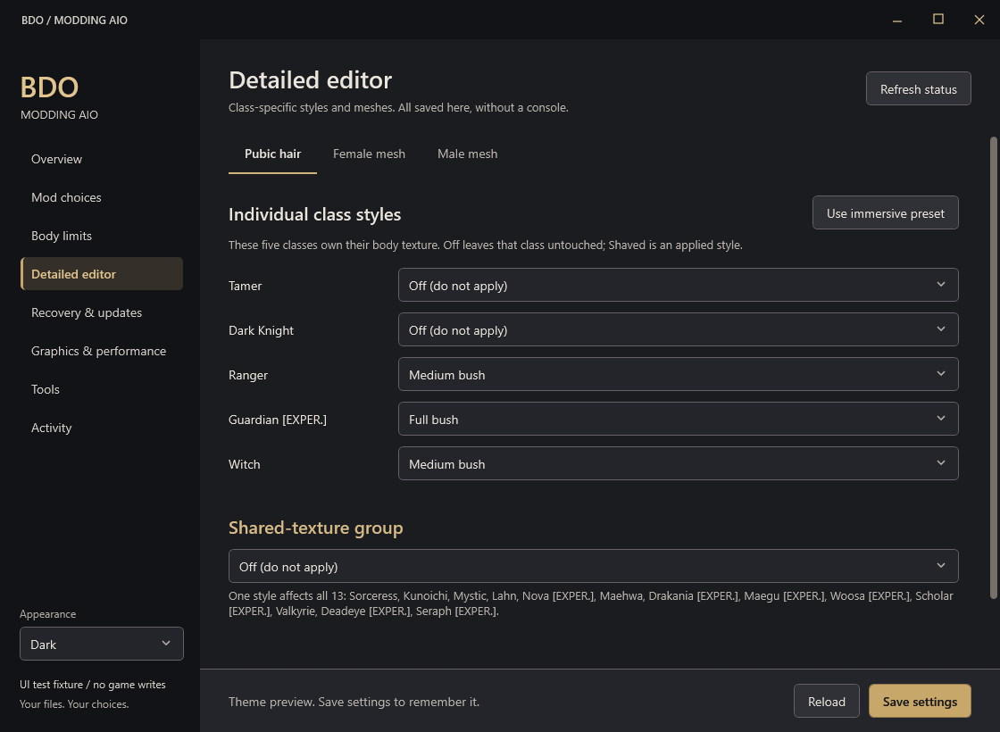
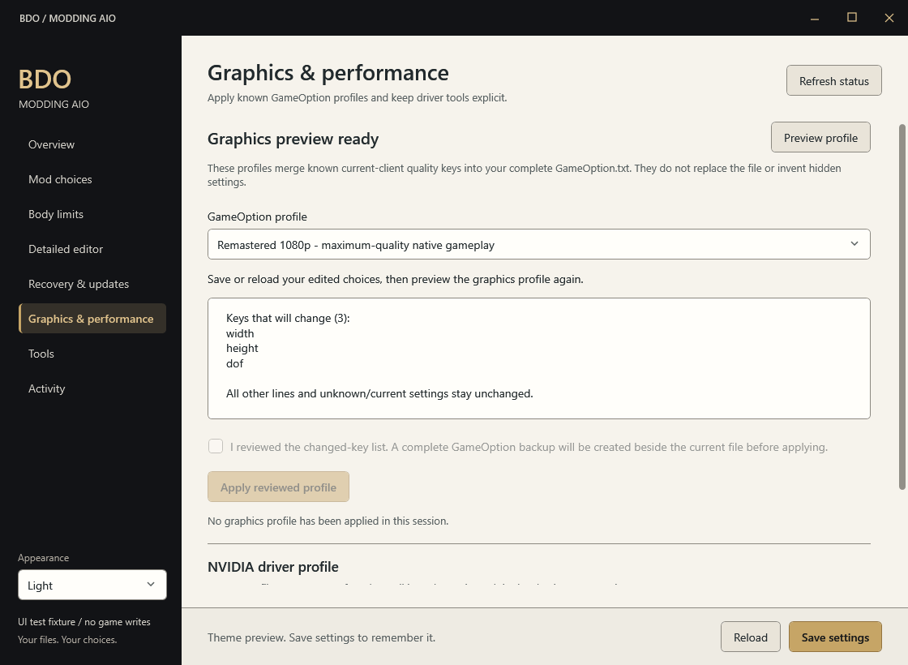
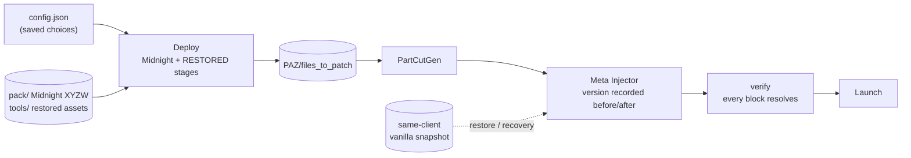

<div align="center">



[](https://github.com/SenjuWoo/BDO-AIO/actions/workflows/ci.yml)
[](https://github.com/SenjuWoo/BDO-AIO/releases/latest)
[](bdo_aio_gui.ps1)
[](tools/bdo_meta)
[](LICENSE)

**[Quick start](#quick-start)** · **[Dashboard](#the-dashboard)** · **[Options](#options-menu-2)** · **[Pipeline](#how-it-works)** · **[Honest status](#honest-status)** · **[Changelog](CHANGELOG.md)**

</div>

BDO Modding AIO is a one-folder Windows installer and dashboard for **Black Desert
Online client mods**. It runs the modern Midnight → PartCutGen → Meta Injector
pipeline for nude bases, armor and underwear hide and the XYZW skimpy collections, and
brings back the classic Resorepless-era extras on top: body-slider Max ceilings, slot
hide, pubic hair styles, censorship texture tiers and authored 3D vagina/penis meshes.
Around that it adds the safety a game patch demands: a read-only meta check before you
launch, client-version-aware vanilla restore, and recovery steps that preview every
change, back it up and ask before they write.

**Current tree: v2.5.0.** Double-click **`START.bat`**.

| Download | What you get |
| --- | --- |
| **[Full offline `.7z` (recommended)](https://github.com/SenjuWoo/BDO-AIO/releases/latest)** | Scripts + **`pack\`** Midnight (~1.8 GB) + injectors. Use this. |
| This git `main` branch | Scripts + docs + tools only: **no** Midnight meshes unless you add `pack\` yourself |

## What you get

- **Midnight** deploy → **PartCutGen** → **Meta Injector**, run in order from one place; a failed step stops the sequence.
- Underwear / armor hide, Suzu + TheGreatSage nude bases, optional **XYZW** skimpy collections.
- **RESTORED** options: body Max ceilings, slot hide, pubic hair, censorship texture tiers, authored 3D vagina/penis.
- **Native dashboard** with Obsidian & Gold **Dark**, **Night** and **Light** themes, a detailed per-class editor and an Activity log. `START-CLASSIC.bat` keeps the original console.
- **Survives client patches.** `verify` proves every meta block resolves before you launch; injections record the client version before and after; restoring a snapshot from a different client version is refused.
- **Recovery that asks first.** Read-only preview, exact change list, per-action acknowledgement, retained originals and a receipt. Nothing is auto-pruned.
- GameOption max-quality profiles merged into your own `GameOption.txt` (unknown keys kept, full backup) + NVIDIA `.nip` import through Orbmu2k's NVIDIA Profile Inspector (not an NVIDIA partnership).
- Optional **EXPERIMENTAL / NOT SAFE** OptiScaler (menu **X**).

## The dashboard

These are the real dashboard pages, rendered by the repo's own UI test
(`tools/bdo_meta/test_dashboard.ps1 -CaptureDir`) from fixture data: a temporary config,
no game folder and no game writes. The status figures are fixture values, not a live scan.


<details>
<summary>More pages: detailed editor, recovery, graphics (Light theme)</summary>






</details>

The full dashboard walk-through (appearance, workflow, graphics, recovery and game
updates) is in [`docs/DASHBOARD.md`](docs/DASHBOARD.md).

## Quick start

1. Download the latest **`BDO-AIO-v*-full.7z`** from [Releases](https://github.com/SenjuWoo/BDO-AIO/releases/latest) (or use this repo + fill `pack\`).
2. Extract to a short path; install **Python 3** if needed (`winget install Python.Python.3.12`).
3. Double-click **`START.bat`** for the dashboard. In **Overview**, choose the live PAZ folder (the one with `pad00000.meta`); if Python is not found, use **Choose Python...**.
4. Set **Mod choices**, **Body limits** and the **Detailed editor**, then **Save settings** (saving does not patch the game).
5. Close the game and its launcher, choose **Apply saved choices**, and finish **PartCutGen** and **Meta Injector** in their own consoles.
6. **Verify current meta** checks the client version and archive references before you launch.

**Requires separately:** [BDO Toolkit 1.3.0](https://www.undertow.club/) for Meta Injector 1.4.1 (not bundled).

### Classic console

`START-CLASSIC.bat` runs the same tools from the original menu:

1. **`9`** verify pack (~1.5–2 GB under `pack\`).
2. **`6`** Full Wizard (or configure options first with **`2`**) → pick live **PAZ** (`pad00000.meta` inside).
3. Finish **PartCutGen**, then **Meta Injector**.
4. Optional: **`G`** GameOption. **`N`** NVIDIA `.nip`. **`X`** OptiScaler (not safe).
5. After a successful re-mod: **`H`** (heisha regen if inject breaks) then wizard again if needed.

| Key | Classic menu entry |
| --- | --- |
| `1` | Set / find game PAZ folder |
| `2` | Options hub (MODERN + RESTORED) |
| `3` / `4` / `5` | Deploy Midnight → Run PartCutGen → Run Meta Injector |
| `6` | Full wizard (Midnight + RESTORED) |
| `A` | Apply all RESTORED choices from config |
| `7` | Open `files_to_patch` (add extra mods) |
| `S` | Scan PAZ status (stock / staged / injected / restored) |
| `H` | Post-patch regen helper (heisha / Midnight) |
| `R` | Restore / clean AIO changes |
| `G` / `N` | Graphics profiles (GameOption) / NVIDIA `.nip` |
| `X` | EXPERIMENTAL upscale (OptiScaler), **NOT SAFE** |
| `8` / `9` | 2026 guide + feature labels / Verify pack integrity |

### After a game patch

- Let the launcher finish, start the game once, re-snapshot vanilla (dashboard: **Create current-client reference**), then re-apply. Restoring a vanilla snapshot taken on a **different client version** is refused; that is what used to look like "corrupted files".
- **Body-size users:** do **not** log in characters saved above stock Max while the client is vanilla. The game clamps and re-saves them (and can overwrite Beauty Album presets). Re-inject body size **first**, then play. AIO snapshots `Documents\Black Desert\Customization` into `backup\` on restore.

## Options (menu 2)

### Feature labels

| Label | Meaning |
| --- | --- |
| **MODERN** | Midnight / Meta Injector 2026 pipeline |
| **RESTORED** | Classic Resorepless-era feature, re-wired here |
| **EXPERIMENTAL** | From-scratch in this AIO only, not a classic restore |

Details: [`docs/FEATURE-LABELS.md`](docs/FEATURE-LABELS.md)

### MODERN

| Area | Options |
| --- | --- |
| Gender | Female / Male / Both |
| Armor hide | All / Pearl / Free / Underwear-only |
| Collections | XYZW outfit packs on/off |

### RESTORED

| Area | Options |
| --- | --- |
| **Body size (Max ceilings only)** | **Recommended** or per-axis **Custom** for five regions. Recommended: breasts X/Y/Z 1.55; thighs Y/Z 1.35; butt cheeks X/Y/Z 1.20; front pelvis/groin Y/Z 1.40; belly X 1.28 and Z 1.45. Thigh X, Pelvis X, and Belly Y stay untouched. Belly X is the sole intentional `HeightAxis` exception and can lengthen the lower torso. Only Max widens; Min/Default and higher class values remain. Restore once before an exact Recommended test if an older injection used breasts above 1.55 or widened Belly Y. |
| **Slot hide** | Gloves / boots / helmets / weapons / stockings |
| **Pubic hair** | Per-class styles; shared-atlas classes share one style; texture-only |
| **Censorship tiers** | Live-client **DXT5/DXT3** transparent blanks only. **Never DXT1**, never `*_cull*`, never 2018 stubs. Default **off**. Mesh/DXT1 built-in shorts need an XYZW remesh; see [`dev/TEXTURE-BLANKING-RULES.md`](dev/TEXTURE-BLANKING-RULES.md). |
| **3D vagina / penis** | Authored meshes only (10 female + 6 male). **Nude body PAC only**: does not overwrite Midnight underwear hide. |

**Butt cheeks** controls cheek shape and roundness; **Front pelvis/groin Z (`pelvis.z`)**
is the main overall pelvis/ass-size control, affecting the front groin and rear.

### Not supported

| Area | Reason |
| --- | --- |
| Genitals on classes with no authored mesh | Reusing another class's PAC steals that class's body *and* skin |
| Separate pubic style per shared-atlas class | 13 females share one texture; material rename made bodies invisible |
| Pubic hair on Corsair | No matching hair bin size |
| "Strip every outfit" via texture censorship | Safe only for DXT5 overlays; geometry shorts need remeshes |

### EXPERIMENTAL

| Area | Options |
| --- | --- |
| Main menu **[X]** | OptiScaler / DLSS-style inject: **NOT SAFE** |

## How it works

```text
NA/EU: Deploy -> PartCutGen -> Meta Injector -> Verify -> Launch
Other regions: same, then Meta Patcher only if your region needs it (not bundled)
```



- Meta Injector is launched through a short-path canonical stage so deep XYZW trees do not hit Windows path limits.
- `pad00000.meta` carries the client version at offset 0. Injections record it before and re-check it after; a mismatch says **DO NOT LAUNCH**. Background: [`dev/CLIENT-PATCH-RULES.md`](dev/CLIENT-PATCH-RULES.md).
- The patching helpers are Python (`tools/bdo_meta/`); the dashboard and classic menu are Windows PowerShell 5.1.


## Why `pack/` is not in git

~1.8 GB / 40k+ files. The full offline payload ships as **`BDO-AIO-v*-full.7z`** on
Releases. A source-only clone is incomplete without that archive or a local `pack\`.
See [`dev/BACKUP.md`](dev/BACKUP.md).

## Layout (full offline tree)

```text
BDO-AIO/
  START.bat              <- run this (dashboard)
  START-CLASSIC.bat      <- original console
  bdo_aio.ps1 / bdo_aio_gui.ps1
  ui/dashboard.xaml
  README.md / CREDITS.md / CHANGELOG.md
  config.example.json    <- ship this; config.json is local-only
  pack/                  <- REQUIRED (~1.5-2 GB) in full releases
  graphics/              <- GameOption patches + nvidia .nip
  tools/                 <- bdo_meta, NPI, restored assets
  experimental/dlss/     <- optional, dangerous
  docs/                  <- dashboard guide, feature labels, ecosystem notes
  dev/                   <- maintainer notes (not needed to play)
```

## What's new

- **2.5.0:** native dashboard with Obsidian & Gold themes; native Graphics & performance page (preview, token, full backup, atomic merge; Remastered 1440p default); native Recovery & updates page with per-action approval; exception-safe injection stage replacement.
- **2.4.2:** catches a rolled-back client version before it wipes your mods: version recorded before/after injection, new `verify`, cross-version restore refused.
- **2.4.1 / 2.4.0:** body limits simplified to **Recommended**, **Custom** and **Keep current**, five regions with 12 explicit axis ceilings.

Full history: [`CHANGELOG.md`](CHANGELOG.md) · version notes: [`VERSION.md`](VERSION.md)

## Honest status

Verified in this tree:

- `CURRENT.txt` / `VERSION.md`: **v2.5.0**
- CI (`.github/workflows/ci.yml`): PowerShell parse + PSScriptAnalyzer, the Windows PowerShell regression suites, JSON validation, Python compile and the Python regression tests (130 tests, 6 skipped, in the run shown above)
- [`VALIDATION.md`](VALIDATION.md): v2.4.1 tool-validated: 94 Python tests at the time, PowerShell suites, read-only live PAZ audit (75 descriptors, 2,383 Max edits, zero byte-length / Min / Default / protected-axis violations). v2.5.0 did not change slider values.
- dashboard images above: rendered by `test_dashboard.ps1` from fixture data

Not claimed:

- that a git clone without `pack\` is playable
- in-game appearance across every class and outfit (still user-tested)
- NVIDIA endorsement of the `.nip` profile

## Credits

[`CREDITS.md`](CREDITS.md): keep it in every zip. This AIO is a wrapper; meshes and
tools belong to Midnight/heisha, Suzu, TheGreatSage, the XYZW authors, the Meta
Injector/PartCutGen authors, the Resorepless lineage, Orbmu2k (NPI), OptiScaler
(experimental), and this repo's menu/tooling.

**Black Desert Online** (c) Pearl Abyss. Client mods can break after patches and may violate ToS; use at your own risk.

## License

[MIT](LICENSE)
